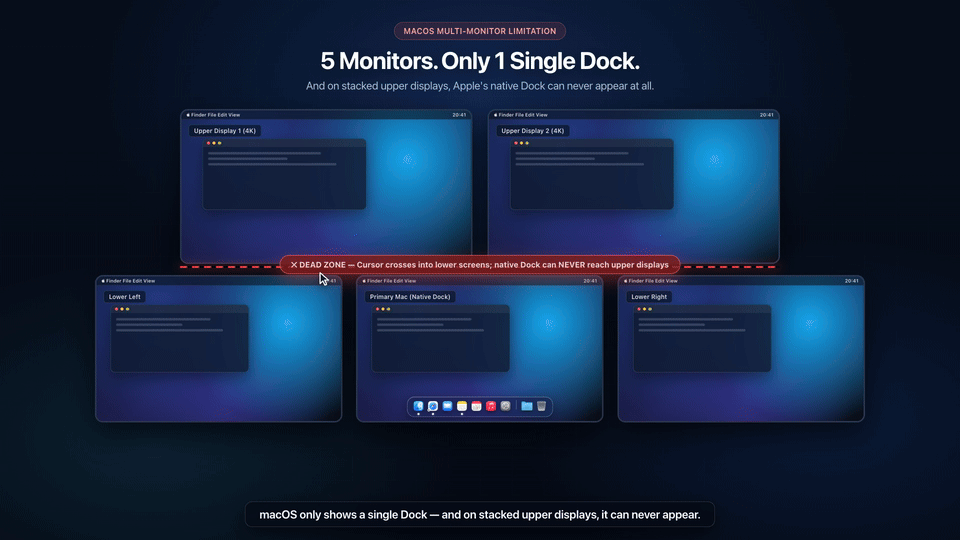

# MultiScreenDock

[](https://github.com/fgomsan/MultiScreenDock/releases/latest)
[](LICENSE)
[](#requirements)
[](https://github.com/fgomsan/MultiScreenDock/actions/workflows/build.yml)
[](https://buymeacoffee.com/fgomsan)

**The macOS Dock only shows on one display.** MultiScreenDock is a native Swift/AppKit menu-bar app that keeps a live copy of that Dock on every connected monitor, including stacked upper displays where the pointer never hits a screen edge and the system Dock cannot appear.

**El Dock de macOS solo aparece en una pantalla.** MultiScreenDock mantiene una copia en vivo en cada monitor, también en pantallas apiladas arriba, donde el Dock del sistema no puede salir. [Guía breve en español](#español).



## Features

- **Two visibility modes.** Auto-hide, revealed by dwelling at the bottom edge, or always visible. On a display with another monitor directly underneath, the dwell is longer (90 / 150 / 250 ms instead of 40 / 80 / 160 ms) so a fast vertical crossing does not pop the bar. An optional pill marks the bottom center while the bar is hidden.
- **The same items as your Dock.** Finder, pinned apps, running apps that are not pinned (with a dot, brighter for the frontmost app), pinned files and folders, and the Trash. Spacers in `com.apple.dock.plist` are skipped. Icons refresh from that plist, from `NSWorkspace` launch/quit/activate notifications, and from **Sync Dock Icons Now**.
- **Stays out of the system Dock's way.** The primary display is skipped by default. On any display where the system Dock is currently taking bottom space, the extra bar hides while **Avoid overlapping where native Dock is visible** is on.
- **Settings where your hand already is.** Right-click the bar, Control-click it, or open **MultiScreenDock Settings** at the bottom of an icon's menu. The same menu is on the menu-bar icon (`dock.rectangle`, or the title "Dock+" if that symbol is missing). Per-display toggles, icon size (28 / 36 / 44 / 52 pt, scaled down to fit a narrow screen, floor 20 pt), hover magnification, and launch at login live there.
- **Clicks that match the Dock closely enough to use.** Click launches or activates. Command-click reveals an app, file, or folder in Finder. Option-click hides an app when that app is already frontmost. Right-click can open, show in Finder, hide, quit, open a Finder window, or empty the Trash. Drop files on an app to open them with it, on a folder to move them into it, or on the Trash to trash them.
- **A panel that does not take focus.** The bar is a non-activating `NSPanel`. Hovering it leaves the current app active. The label under the pointer is the item name. Hover magnification scales that one icon to 1.18×.
- **8 languages built in** (English, Español, Français, Deutsch, Português, Italiano, 日本語, and 简体中文), detected automatically from macOS or switched manually at any time from the **Language** submenu.

## Requirements

- macOS 13.0 or later (`LSMinimumSystemVersion` is 13.0; the binary is built `-target arm64-apple-macos13.0` and `x86_64-apple-macos13.0`).
- Apple silicon or Intel. Release and `./build.sh` both produce one universal binary.
- More than one display is the case this is for. With a single display the bar stays off, because **Skip primary display** defaults to on.

Build from source also needs the Xcode Command Line Tools (`xcode-select --install`), which provide `swiftc`, `lipo`, `iconutil`, and `codesign`.

## Install

### Download a release

1. Download [`MultiScreenDock-v1.3.1-macOS.zip`](https://github.com/fgomsan/MultiScreenDock/releases/download/v1.3.1/MultiScreenDock-v1.3.1-macOS.zip) from the [latest release](https://github.com/fgomsan/MultiScreenDock/releases/latest).
2. Unzip it and move `MultiScreenDock.app` to `/Applications`.
3. The v1.3.1 app is ad-hoc signed (`codesign --sign -`) and has no Developer ID certificate and no notarization ticket yet. Gatekeeper blocks the quarantined download until you allow it once:

   ```bash
   xattr -dr com.apple.quarantine /Applications/MultiScreenDock.app
   open /Applications/MultiScreenDock.app
   ```

   Right-click the app and choose **Open**, or allow it from **System Settings → Privacy & Security**, if you prefer not to use the terminal.

### Homebrew

There is no `brew install --cask multiscreendock` from `homebrew/homebrew-cask` yet. A cask for the v1.3.1 zip is in [`packaging/homebrew/multiscreendock.rb`](packaging/homebrew/multiscreendock.rb). It can be installed from a checkout, or from a personal tap once `fgomsan/homebrew-tap` exists:

From a checkout of this repo:

```bash
brew install --cask --no-quarantine ./packaging/homebrew/multiscreendock.rb
```

After a personal tap repository `fgomsan/homebrew-tap` exists and contains this cask:

```bash
brew tap fgomsan/tap
brew install --cask multiscreendock
```

`--no-quarantine` matters for this build: Homebrew quarantines cask downloads, and Gatekeeper rejects this ad-hoc signature. After a normal tap install, clear quarantine on the copy in `/Applications` or `~/Applications` with the `xattr` command above. A Developer ID signature and an Apple notarization ticket are what remove that step. See the release workflow notes in [`.github/workflows/notarize-release.yml`](.github/workflows/notarize-release.yml).

### Build from source

```bash
git clone https://github.com/fgomsan/MultiScreenDock.git
cd MultiScreenDock
./Tests/run_tests.sh
./build.sh
open ./MultiScreenDock.app
```

`./build.sh` writes `./MultiScreenDock.app`, ad-hoc signs it, and does not notarize it. A local build is not quarantined, so Gatekeeper's download check does not apply.

## Usage

MultiScreenDock runs as a menu-bar app (`LSUIElement`). It has no Dock icon and no main window.

The menu-bar icon, a right-click on the bar, or **MultiScreenDock Settings** on an item opens the same menu:

| Setting | What it does | Default |
| --- | --- | --- |
| Auto-hide / always visible | Slide up after a short dwell at the bottom edge, or stay on screen | Auto-hide |
| Bottom-edge indicator | A small pill at the bottom center while the bar is hidden | On |
| Hover reveal sensitivity | Fast, balanced, or relaxed dwell and hide delay | Balanced |
| Skip primary display | Leave the display that hosts the system Dock alone | On |
| Auto-hide Apple's native Dock | Asks System Events to toggle the system Dock's auto-hide | Off |
| Avoid overlapping the native Dock | Hide the extra bar on a display whose bottom `visibleFrame` is inset | On |
| Allow on full-screen apps | Join full-screen spaces (`fullScreenAuxiliary`) | On |
| Smooth hover magnification | Scale the icon under the pointer | On |
| Show running unpinned apps | Append regular running apps that are not pinned | On |
| Icon size | 28, 36, 44, or 52 pt | The system Dock's tile size, when that value is between 20 and 80 |
| Active displays | Turn individual screens on or off (persisted by hardware display UUID) | All non-primary screens |
| Language | Automatic (macOS) or manual override (EN, ES, FR, DE, PT, IT, JA, ZH) | Automatic |
| Launch at Login | Registers with `SMAppService.mainApp` (System Settings → Login Items) | Off |

**Sync Dock Icons Now** (⌘R in the menu) re-reads the Dock plist immediately. Quit is ⌘Q in that menu.

Click behavior:

- **Click** a pinned or running app to launch or activate it. Click Finder to activate Finder, opening a window at your home folder only when Finder has no windows. Click a file or folder to open it. Click the Trash to open it.
- **Command-click** an app, file, or folder to reveal it in Finder. Finder and the Trash ignore the modifier and perform their normal click.
- **Option-click** an app that is already frontmost to hide it. Otherwise the click activates the app.
- **Right-click** an item for Open/Show, Show in Finder, Hide, Quit, New Finder Window, or Empty Trash. The Trash's Empty item is enabled only when the Trash is not empty.
- **Drag files** onto an app, a folder, or the Trash. A drop on a folder moves the files into that folder. A drop on the Trash uses `FileManager.trashItem`.

The reveal strip sits on the bottom center of each enabled display. Its width is the wider of 45% of the display and the bar plus 64 pt, and it is never wider than the display minus 24 pt. It is 20 pt tall, or 26 pt when another display sits directly below. Corners outside that strip do not summon the bar. Once visible, the keep-alive zone always forms a strict superset of the reveal strip plus padding around the bar, then waits out a hide delay (0.22 / 0.32 / 0.45 s).

## Permissions

The Dock bar itself does not request Accessibility or Screen Recording. The code never calls `AXIsProcessTrusted`, never monitors keystrokes, and never captures the screen. Auto-hide uses `NSEvent.addGlobalMonitorForEvents` for mouse movement and drags. Apple's documentation requires Accessibility for key monitors; this app does not install one.

macOS asks for **Automation** permission only when a feature sends Apple events:

| Action | Target | If you deny it |
| --- | --- | --- |
| Finder-icon click, and New Finder Window | Finder | A Finder click falls back to launching Finder.app. **New Finder Window** does not open a window. |
| Empty Trash | Finder | The Trash stays as it is. Opening the Trash still works. |
| Auto-hide Apple's native Dock | System Events | Prompts you to either open System Settings → Automation or explicitly confirm restarting the Dock (`defaults write` + `killall Dock`). |

`Info.plist` includes `NSAppleEventsUsageDescription` for that prompt. Reading `~/Library/Preferences/com.apple.dock.plist` uses your own preferences file and does not raise a permission dialog.

**Launch at Login** uses Apple's `SMAppService.mainApp` API (visible in **System Settings → General → Login Items**). Any legacy `~/Library/LaunchAgents/io.github.fgomsan.multiscreendock.plist` from earlier versions is migrated and cleaned up automatically.

## Uninstall

Quit from the menu (**Quit MultiScreenDock**), then delete the app.

```bash
osascript -e 'tell application id "io.github.fgomsan.MultiScreenDock" to quit' || true
rm -rf /Applications/MultiScreenDock.app
launchctl bootout "gui/$(id -u)/io.github.fgomsan.multiscreendock" 2>/dev/null || true
rm -f ~/Library/LaunchAgents/io.github.fgomsan.multiscreendock.plist
rm -f ~/Library/Preferences/io.github.fgomsan.MultiScreenDock.plist
```

The LaunchAgent file exists only if **Launch at Login** was turned on. The preferences file holds the menu settings (mode, sizes, disabled displays).

From Homebrew, once the cask is installed:

```bash
brew uninstall --cask multiscreendock
brew uninstall --cask --zap multiscreendock
```

`uninstall` quits the app, boots out the LaunchAgent label, and deletes that plist. `--zap` also deletes the preferences plist.

## Limitations

- The bar is always centered on the **bottom** edge. A system Dock pinned to the left or right edge is not mirrored, and overlap detection only looks at the bottom `visibleFrame` inset.
- This is a separate panel, not Apple's Dock process. There is no bounce, no notification badge, no download progress, no folder stack or fan (a folder opens in Finder), and no Dock spacers. Hover magnification scales the single icon under the pointer; it is not the system Dock's magnification curve.
- Dropping files on a folder **moves** them (`FileManager.moveItem`). If a destination name collision or permission error occurs, the file stays in place and an alert reports which items could not be moved.
- **Upper** / **Lower** in the displays menu is a label for screens whose `minY` is at least 600 points. The stacked-display dwell uses actual frame geometry, not that label.
- The full-screen setting adds `fullScreenAuxiliary` at Dock window level. Some exclusive full-screen windows still cover the bar.
- "Sync" follows the Dock plist and `NSWorkspace` notifications. It is not a private Dock API. A plist change is picked up on the next 0.8 second timer tick, or immediately (clearing cached icons) from **Sync Dock Icons Now**.
- While the pointer is moving, auto-hide evaluates at most about 60 times a second. A timer also fires every 0.8 seconds: it reloads icons when the Dock plist or the native Dock's bottom inset changed, and otherwise re-checks the pointer in auto-hide mode.
- v1.3.1 is ad-hoc signed. Gatekeeper does not treat the downloaded zip as notarized software until Apple Developer ID notarization is enabled.
- Interface strings are included for 8 languages (English, Spanish, French, German, Portuguese, Italian, Japanese, and Simplified Chinese). Other system locales fall back to English unless overridden in the **Language** submenu.

## FAQ

**Does it replace the Dock?**
It draws its own bar from the Dock's plist and from running apps. The system Dock keeps running. The primary display is left to the system Dock unless you turn **Skip primary display** off.

**I only have one monitor. Why is there no bar?**
That display is the primary display, and it is skipped by default. Turn **Skip primary display** off.

**Why did macOS say the app is from an unidentified developer?**
The release zip is signed ad hoc, with an empty certificate chain and no notarization ticket. Clear the quarantine flag or use **Open** once, as in [Install](#download-a-release). A future Developer ID build is what removes the warning.

**Does it need Accessibility?**
Not for this code. No Accessibility trust prompt is part of launch. Automation prompts appear only for the Finder and System Events actions in [Permissions](#permissions).

**What happens if I change icon size or pinned apps in System Settings?**
Pinned apps and folders are re-read when `com.apple.dock.plist` changes. The in-app icon size is independent after you pick a size; the first launch copies the system tile size when it falls between 20 and 80 pt.

**Can I put the bar on the left or the right?**
No. Geometry, hit testing, and the reveal strip are bottom-edge only.

**Is the Homebrew cask live?**
The cask file is in this repo. It is not in `homebrew/homebrew-cask`. That tap accepts a macOS app only when Gatekeeper accepts the download on a default install, which this ad-hoc signature does not pass. Install from the file in the repo, or from a personal tap named `fgomsan/homebrew-tap`, until a notarized build is published.

## Español

MultiScreenDock es una app de barra de menús, en Swift/AppKit, sin dependencias. Muestra en cada monitor una barra sincronizada con tu Dock: Finder, apps fijadas, apps abiertas no fijadas (con un punto; más brillante si están delante), archivos y carpetas fijados, y la Papelera. El monitor principal se omite por defecto para no tapar el Dock del sistema.

En pantallas apiladas, el borde inferior del monitor de arriba no es un tope físico. La barra espera un poco más en ese borde (90, 150 o 250 ms según la sensibilidad) para no abrirse cuando el cursor solo está de paso hacia el monitor de abajo.

**Instalación.** Descarga [`MultiScreenDock-v1.3.1-macOS.zip`](https://github.com/fgomsan/MultiScreenDock/releases/download/v1.3.1/MultiScreenDock-v1.3.1-macOS.zip), muévela a `/Applications` y, la primera vez:

```bash
xattr -dr com.apple.quarantine /Applications/MultiScreenDock.app
open /Applications/MultiScreenDock.app
```

La versión 1.3.1 está firmada ad hoc, sin notarizar aún. Homebrew oficial todavía no sirve el cask; el archivo está en `packaging/homebrew/multiscreendock.rb`. Para compilar y ejecutar los tests: `./Tests/run_tests.sh && ./build.sh` en macOS 13 o posterior, con las Command Line Tools.

**Permisos.** No pide Accesibilidad ni Grabación de Pantalla. macOS pedirá permiso de Automatización al controlar el Finder (clic en el icono de Finder, ventana nueva, vaciar la Papelera) o System Events (ocultar automáticamente el Dock del sistema). Si rechazas System Events, ofrece abrir Ajustes del Sistema o confirmar explícitamente el reinicio del Dock.

**Uso.** Clic derecho sobre la barra, o el icono `dock.rectangle` en la barra de menús. Clic abre o activa. ⌘-clic muestra el ítem en el Finder (salvo Finder y la Papelera). ⌥-clic oculta la app si ya está delante. Arrastrar archivos a una carpeta los mueve dentro.

**Desinstalar.** Sal de la app y borra `MultiScreenDock.app`. Si activaste **Abrir al iniciar sesión**, borra también `~/Library/LaunchAgents/io.github.fgomsan.multiscreendock.plist`. Los ajustes están en `~/Library/Preferences/io.github.fgomsan.MultiScreenDock.plist`.

La barra solo existe en el borde inferior. No reproduce rebote, globos de notificación, pilas de carpetas ni el aumento en curva del Dock del sistema. Incluye selector de idioma en vivo (8 idiomas) en el menú.

## Support

MultiScreenDock is free and open source. If it makes your multi-monitor workflow better, you can support its development on [Buy Me a Coffee](https://buymeacoffee.com/fgomsan).

## License

[MIT](LICENSE). Copyright (c) 2026 Fernando Gómez Sancha.
