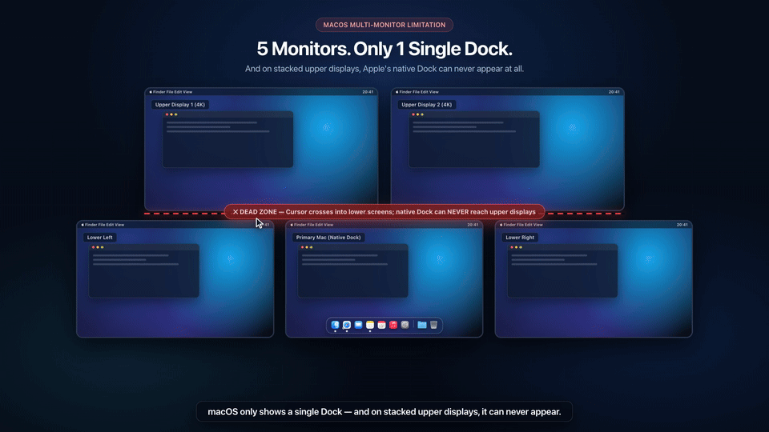
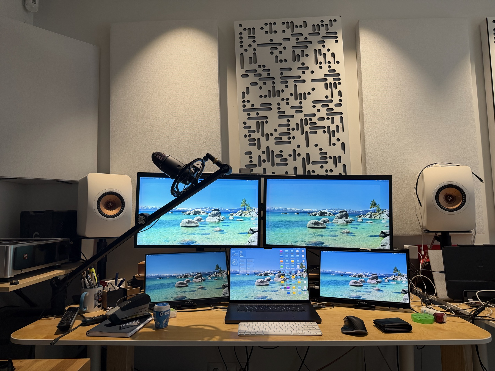

# MultiScreenDock

[](https://multiscreendock.fgomsan.here.now/)
[](https://github.com/fgomsan/MultiScreenDock/releases/latest)
[](https://github.com/fgomsan/MultiScreenDock/actions/workflows/notarize-release.yml)
[](https://apps.microsoft.com/detail/9N08WLJHKWLR)
[](LICENSE)
[](#requirements)
[](https://github.com/fgomsan/MultiScreenDock/actions/workflows/build.yml)
[](https://buymeacoffee.com/fgomsan)

**The macOS Dock only shows on one display.** MultiScreenDock is a native Swift/AppKit menu-bar app that keeps a live copy of that Dock on every connected monitor, including stacked upper displays where the pointer never hits a screen edge and the system Dock cannot appear.

**El Dock de macOS solo aparece en una pantalla.** MultiScreenDock mantiene una copia en vivo en cada monitor, también en pantallas apiladas arriba, donde el Dock del sistema no puede salir. [Guía breve en español](#español).

## What's New in v1.5.0

- **Bottom, Left & Right Dock Positions (`Position on Screen`):** Automatically follows your native macOS Dock orientation (`orientation` in `com.apple.dock.plist`) or lets you pin MultiScreenDock to **Bottom**, **Left**, or **Right** — with full vertical 120 Hz raised-cosine magnification, inward icon lift/bounce, horizontal divider lines, side-anchored Hover Bubbles & Folder Stacks (**Fan**, **Grid**, and **List**), and edge-aware native Dock overlap detection on all 3 edges.
- **Light Glass & Dark Glass Appearance (`Appearance`):** Automatically follows macOS Light and Dark Mode live (`AppleInterfaceThemeChangedNotification`) or locks to **Light Glass** (translucent `.aqua` frosted glass with dark charcoal running dots) or **Dark Glass** (`.darkAqua` HUD glass).
- **Per-Display Fullscreen Auto-Suppression:** Detects fullscreen apps and videos per monitor via `CGWindowListCopyWindowInfo` and automatically hides the Dock on that display (`Allow on full-screen apps` now defaults to `Off`) while keeping your Docks active on all other monitors.
- **2,233 Automated CI Assertions:** Expanded test suite covering horizontal & vertical wave geometry, edge triggers, twin-monitor EDID disambiguation, and Mac App Store / App Sandbox compliance.



<p align="center">
  
  <br />
  <em>The 5-display stacked macOS desk MultiScreenDock was built for: 2× LG UltraFine (upper row) above a 16" MacBook Pro flanked by 2× ARZOPA portable displays (lower row).</em>
</p>

## Features

- **Three visibility modes.** Auto-hide (revealed by dwelling at the bottom edge), **Smart auto-hide** (stays visible when the bottom of a display is clear, and automatically hides per-monitor only when a window overlaps the Dock area — using public `CGWindowListCopyWindowInfo` geometry with zero Accessibility or Screen Recording permissions), or always visible. On a display with another monitor directly underneath, the dwell is longer (90 / 150 / 250 ms instead of 40 / 80 / 160 ms) so a fast vertical crossing does not pop the bar. An optional pill marks the bottom center while the bar is hidden.
- **The same items as your Dock.** Finder, pinned apps, running apps that are not pinned (with a dot, brighter for the frontmost app), pinned files and folders, and the Trash. Spacers in `com.apple.dock.plist` are skipped. Icons refresh from that plist, from `NSWorkspace` launch/quit/activate notifications, and from **Sync Dock Icons Now**.
- **Stays out of the system Dock's way.** The primary display is skipped by default. On any display where the system Dock is currently taking bottom space, the extra bar hides while **Avoid overlapping where native Dock is visible** is on.
- **Settings where your hand already is.** Right-click the bar, Control-click it, or open **MultiScreenDock Settings** at the bottom of an icon's menu. The same menu is on the menu-bar icon (`dock.rectangle`, or the title "Dock+" if that symbol is missing). Per-display toggles, icon size (28 / 36 / 44 / 52 pt, scaled down to fit a narrow screen, floor 20 pt or 14 pt in extreme overflow), hover magnification, and launch at login live there.
- **Clicks that match the Dock closely enough to use.** Click launches or activates. Clicking a pinned folder (`Downloads`, `Documents`, etc.) opens a native **Folder Stack** (**Fan**, **Grid**, or **List** matching your macOS Dock setting, with QuickLook thumbnails, subfolder drill-down, and drag-out); Option-click opens the folder in Finder. Command-click reveals an app, file, or folder in Finder. Option-click hides an app when that app is already frontmost. Right-click can open, show in Finder, hide, quit, switch folder stack style, open a Finder window, or empty the Trash (with confirmation). Drop files on an app to open them with it, on a folder to move them into it (or copy on Option-drag / across volumes), or on the Trash to trash them.
- **A panel that does not take focus.** The bar is a non-activating `NSPanel`. Hovering it leaves the current app active. The label glides smoothly above the hovered icon, and hover magnification renders a zero-latency 120 Hz raised-cosine wave across neighboring icons (up to 1.42×) with focal-point locking so the icon under your pointer never drifts sideways.
- **8 languages built in** (English, Español, Français, Deutsch, Português, Italiano, 日本語, and 简体中文), detected automatically from macOS or switched manually at any time from the **Language** submenu.

## Requirements

- macOS 13.0 or later (`LSMinimumSystemVersion` is 13.0; the binary is built `-target arm64-apple-macos13.0` and `x86_64-apple-macos13.0`).
- Apple silicon or Intel. Release and `./build.sh` both produce one universal binary.
- More than one display is the case this is for. With a single display the bar stays off, because **Skip primary display** defaults to on.

Build from source also needs the Xcode Command Line Tools (`xcode-select --install`), which provide `swiftc`, `lipo`, `iconutil`, and `codesign`.

## Install

### Homebrew (Recommended)

```bash
brew tap fgomsan/tap
brew install --cask multiscreendock
```

### Download a release

1. Download [`MultiScreenDock-v1.5.0-macOS.zip`](https://github.com/fgomsan/MultiScreenDock/releases/download/v1.5.0/MultiScreenDock-v1.5.0-macOS.zip) from the [latest release](https://github.com/fgomsan/MultiScreenDock/releases/latest).
2. Unzip it, move `MultiScreenDock.app` to `/Applications`, and open it.
3. Official releases (`v1.3.2+`) are signed with an Apple **Developer ID Application** certificate (`G387RJ72S5`) and **notarized by Apple**, so macOS Gatekeeper opens them directly without warnings.

### Build from source

```bash
git clone https://github.com/fgomsan/MultiScreenDock.git
cd MultiScreenDock
./Tests/run_tests.sh
./build.sh
open ./MultiScreenDock.app
```

`./build.sh` writes `./MultiScreenDock.app`, ad-hoc signs it, and does not notarize it. A local build is not quarantined, so Gatekeeper's download check does not apply.

## Usage

MultiScreenDock runs as a menu-bar app (`LSUIElement`). It has no Dock icon and no main window.

The menu-bar icon, a right-click on the bar, or **MultiScreenDock Settings** on an item opens the same menu:

| Setting | What it does | Default |
| --- | --- | --- |
| Auto-hide / always visible | Slide up after a short dwell at the bottom edge, or stay on screen | Auto-hide |
| Bottom-edge indicator | A small pill at the bottom center while the bar is hidden | On |
| Hover reveal sensitivity | Fast, balanced, or relaxed dwell and hide delay | Balanced |
| Skip primary display | Leave the display that hosts the system Dock alone | On |
| Auto-hide Apple's native Dock | Asks System Events to toggle the system Dock's auto-hide | Off |
| Avoid overlapping the native Dock | Hide the extra bar on a display where the native Dock is visible on the active edge | On |
| Allow on full-screen apps | Join full-screen spaces (`fullScreenAuxiliary`) instead of auto-suppressing on fullscreen monitors | Off |
| Smooth hover magnification | Continuous 120 Hz raised-cosine wave across neighboring icons (horizontal & vertical) | On |
| Position on Screen | Same as macOS Dock (Auto), Bottom, Left, or Right | Same as macOS Dock (Auto) |
| Appearance | System (Follow macOS Light / Dark), Light Glass, or Dark Glass | System |
| Folder stacks style | Follow macOS Dock (`Fan` / `Grid` / `List`), or override globally | macOS Dock default |
| Show running unpinned apps | Append regular running apps that are not pinned | On |
| Icon size | 28, 36, 44, or 52 pt | The system Dock's tile size, when that value is between 20 and 80 |
| Active displays | Turn individual screens on or off (persisted by hardware UUID, with automatic slot disambiguation for identical twin monitors) | All non-primary screens |
| Language | Automatic (macOS) or manual override (EN, ES, FR, DE, PT, IT, JA, ZH) | Automatic |
| Launch at Login | Registers with `SMAppService.mainApp` (System Settings → Login Items) | Off |
| Check for Updates | Manual check + subtle menu-bar update indicator & verified 1-click self-update | Automatic (every 24h) |
| Suggest an Improvement | Opens a pre-filled GitHub Issue template from the menu | — |

**Sync Dock Icons Now** (⌘R in the menu) re-reads the Dock plist immediately. Quit is ⌘Q in that menu.

Click behavior:

- **Click** a pinned or running app to launch or activate it. Click Finder to activate Finder, opening a window at your home folder only when Finder has no windows. Click a pinned folder to open its **Folder Stack** (**Fan**, **Grid**, or **List**), or **Option-click** it to open in Finder. Click a file or the Trash to open it.
- **Command-click** an app, file, or folder to reveal it in Finder. Finder and the Trash ignore the modifier and perform their normal click.
- **Option-click** an app that is already frontmost to hide it. Otherwise the click activates the app.
- **Right-click** an item for Open/Show, Show in Finder, Hide, Quit, New Finder Window, or Empty Trash. The Trash's Empty item is enabled only when the Trash is not empty.
- **Drag files** onto an app, a folder, or the Trash. A drop on a folder moves the files into that folder. A drop on the Trash uses `FileManager.trashItem`.

The reveal strip sits on the bottom center of each enabled display. Its width is the wider of 45% of the display and the bar plus 64 pt, and it is never wider than the display minus 24 pt. It is 20 pt tall, or 26 pt when another display sits directly below. Corners outside that strip do not summon the bar. Once visible, the keep-alive zone always forms a strict superset of the reveal strip plus padding around the bar, then waits out a hide delay (0.22 / 0.32 / 0.45 s).

## Permissions

The Dock bar itself does not request Accessibility or Screen Recording. The code never calls `AXIsProcessTrusted`, never monitors keystrokes, and never captures the screen. Auto-hide uses `NSEvent.addGlobalMonitorForEvents` for mouse movement and drags. Apple's documentation requires Accessibility for key monitors; this app does not install one.

macOS asks for **Automation** permission only when a feature sends Apple events:

| Action | Target | If you deny it |
| --- | --- | --- |
| Finder-icon click, and New Finder Window | Finder | A Finder click falls back to launching Finder.app. **New Finder Window** does not open a window. |
| Empty Trash | Finder | The Trash stays as it is. Opening the Trash still works. |
| Auto-hide Apple's native Dock | System Events | Prompts you to either open System Settings → Automation or explicitly confirm restarting the Dock (`defaults write` + `killall Dock`). |

`Info.plist` includes `NSAppleEventsUsageDescription` for that prompt. Reading `~/Library/Preferences/com.apple.dock.plist` uses your own preferences file and does not raise a permission dialog.

**Launch at Login** uses Apple's `SMAppService.mainApp` API (visible in **System Settings → General → Login Items**). Any legacy `~/Library/LaunchAgents/io.github.fgomsan.multiscreendock.plist` from earlier versions is migrated and cleaned up automatically.

## Uninstall

Turn off **Launch at Login** from the menu (if enabled), quit from **Quit MultiScreenDock**, then delete the app.

```bash
osascript -e 'tell application id "io.github.fgomsan.MultiScreenDock" to quit' || true
rm -rf /Applications/MultiScreenDock.app
rm -f ~/Library/Preferences/io.github.fgomsan.MultiScreenDock.plist
```

**Launch at Login** uses `SMAppService.mainApp`, so macOS automatically cleans up or lets you toggle the entry in **System Settings → General → Login Items**. The preferences file holds the menu settings (mode, sizes, disabled displays).

From Homebrew, once the cask is installed:

```bash
brew uninstall --cask multiscreendock
brew uninstall --cask --zap multiscreendock
```

`uninstall` quits the app and removes its Login Item registration. `--zap` also deletes the preferences plist.

## Limitations

- This is a separate panel, not Apple's Dock process. There is no multi-bounce launch animation, no notification badge count, no inline Safari/App Store download progress bar, no web URL tiles (`url-tile`), and no Dock spacers.
- Dropping files on a folder **moves** them on the same volume (`FileManager.moveItem`) and **copies** them when Option-dragging or dropping across volumes (`FileManager.copyItem`). If a destination name collision or permission error occurs, the source file stays intact and an alert reports which items failed.
- **Upper** / **Lower** in the displays menu and the stacked-display/side-by-side crossing dwell derive from actual display adjacency (`hasAdjacentMonitor`).
- By default, **Allow on full-screen apps** is off and MultiScreenDock automatically suppresses the Dock on any monitor currently showing a fullscreen window. If enabled, it adds `fullScreenAuxiliary` at Dock window level (some exclusive full-screen games may still cover the bar).
- "Sync" follows the Dock plist and `NSWorkspace` notifications. It is not a private Dock API. A plist change is picked up on the next 0.8 second timer tick, or immediately (clearing cached icons) from **Sync Dock Icons Now**.
- While the pointer is moving, auto-hide evaluates at most about 60 times a second. A timer also fires every 0.8 seconds: it reloads icons when the Dock plist or the native Dock's bottom inset changed, and otherwise re-checks the pointer in auto-hide mode.
- Interface strings are included for 8 languages (English, Spanish, French, German, Portuguese, Italian, Japanese, and Simplified Chinese). Other system locales fall back to English unless overridden in the **Language** submenu.

## FAQ

**Does it replace the Dock?**
It draws its own bar from the Dock's plist and from running apps. The system Dock keeps running. The primary display is left to the system Dock unless you turn **Skip primary display** off.

**I only have one monitor. Why is there no bar?**
That display is the primary display, and it is skipped by default. Turn **Skip primary display** off (and if Apple's native Dock is visible at the bottom, either auto-hide the native Dock or turn **Avoid overlapping where native Dock is visible** off).

**Is it signed and notarized?**
Yes. Starting with `v1.3.2`, official releases are built in GitHub Actions, signed with Developer ID (`G387RJ72S5`), notarized with Apple's notary service, and stapled. Local `./build.sh` builds remain ad-hoc signed for development.

**Does it need Accessibility?**
Not for this code. No Accessibility trust prompt is part of launch. Automation prompts appear only for the Finder and System Events actions in [Permissions](#permissions).

**What happens if I change icon size or pinned apps in System Settings?**
Pinned apps and folders are re-read when `com.apple.dock.plist` changes. The in-app icon size is independent after you pick a size; the first launch copies the system tile size when it falls between 20 and 80 pt.

**Can I put the bar on the left or the right?**
Yes! Starting with `v1.5.0`, MultiScreenDock automatically follows your native macOS Dock orientation (**Bottom**, **Left**, or **Right**), or you can override it manually under **Position on Screen**.

**Is the Homebrew cask live?**
Yes, via the official tap (`brew tap fgomsan/tap && brew install --cask multiscreendock`). The cask definition is also mirrored in [`packaging/homebrew/multiscreendock.rb`](packaging/homebrew/multiscreendock.rb).

## Español

MultiScreenDock es una app de barra de menús, en Swift/AppKit, sin dependencias. Muestra en cada monitor una barra sincronizada con tu Dock: Finder, apps fijadas, apps abiertas no fijadas (con un punto; más brillante si están delante), archivos y carpetas fijados, y la Papelera. El monitor principal se omite por defecto para no tapar el Dock del sistema.

En pantallas apiladas o contiguas, cuando el borde activo comparte frontera con otro monitor, la barra espera un poco más en ese borde (90, 150 o 250 ms según la sensibilidad) para no abrirse cuando el cursor solo está de paso hacia la otra pantalla.

**Novedades en v1.5.0:**
- **Posición Abajo, Izquierda o Derecha (`Posición en pantalla`):** Sigue automáticamente la orientación de tu Dock de macOS o fíjalo abajo, a la izquierda o a la derecha, con ola cosenoidal vertical a 120 Hz y etiquetas/carpetas desplegadas hacia el interior de la pantalla.
- **Cristal Claro y Cristal Oscuro (`Apariencia`):** Se adapta en vivo al Modo Claro y Oscuro de macOS o permite elegir manualmente Cristal claro o Cristal oscuro.
- **Ocultación automática en pantalla completa por monitor:** Se oculta automáticamente en el monitor donde tengas un vídeo o app a pantalla completa mientras sigue activo en el resto de pantallas.

**Instalación.** Con Homebrew:

```bash
brew tap fgomsan/tap
brew install --cask multiscreendock
```

O descarga [`MultiScreenDock-v1.5.0-macOS.zip`](https://github.com/fgomsan/MultiScreenDock/releases/download/v1.5.0/MultiScreenDock-v1.5.0-macOS.zip), descomprímela, mueve `MultiScreenDock.app` a `/Applications` y ábrela directamente (firmada con Apple Developer ID y notarizada por Apple, sin avisos de Gatekeeper). Para compilar desde código fuente y ejecutar los tests: `./Tests/run_tests.sh && ./build.sh` en macOS 13 o posterior.

**Permisos.** No pide Accesibilidad ni Grabación de Pantalla. macOS pedirá permiso de Automatización al controlar el Finder (clic en el icono de Finder, ventana nueva, vaciar la Papelera) o System Events (ocultar automáticamente el Dock del sistema). Si rechazas System Events, ofrece abrir Ajustes del Sistema o confirmar explícitamente el reinicio del Dock.

**Uso.** Clic derecho sobre la barra, o el icono `dock.rectangle` en la barra de menús. Clic abre o activa (y en carpetas fijadas como `Descargas` despliega la **pila nativa** en **Abanico**, **Cuadrícula** o **Lista** con miniaturas QuickLook; ⌥-clic abre la carpeta en el Finder). ⌘-clic muestra el ítem en el Finder (salvo Finder y la Papelera). ⌥-clic oculta la app si ya está delante. Arrastrar archivos a una carpeta los mueve dentro (o los copia con ⌥-arrastrar o entre volúmenes distintos).

**Desinstalar.** Desactiva **Abrir automáticamente al iniciar sesión** en el menú (si estaba activo), sal de la app y borra `MultiScreenDock.app`. Los ajustes están en `~/Library/Preferences/io.github.fgomsan.MultiScreenDock.plist`.

Soporta los bordes inferior, izquierdo y derecho, aumento continuo en onda cosenoidal a 120 Hz con bloqueo focal bajo el puntero, apariencia en Cristal claro y oscuro, pilas de carpetas desplegables y selector de idioma en vivo (8 idiomas) en el menú; no reproduce globos numéricos de notificación ni barras de progreso de descarga.

## Support

MultiScreenDock is free and open source. If it makes your multi-monitor workflow better, you can support its development on [Buy Me a Coffee](https://buymeacoffee.com/fgomsan).

## License

[MIT](LICENSE). Copyright (c) 2026 Fernando Gómez Sancha.
